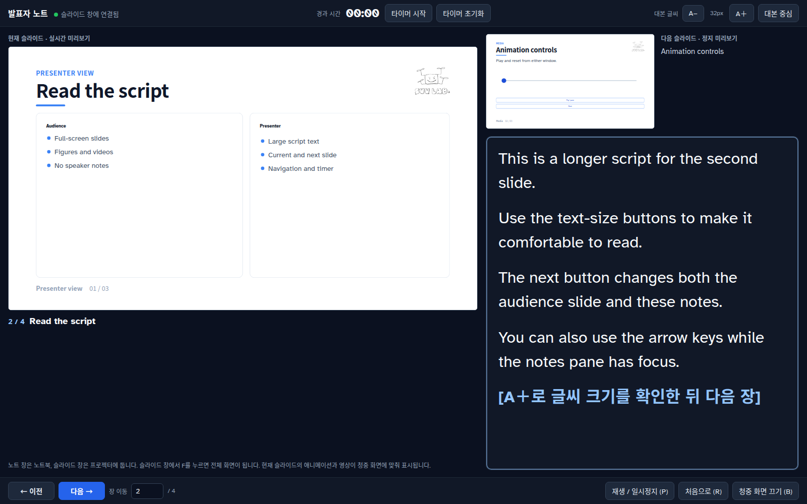
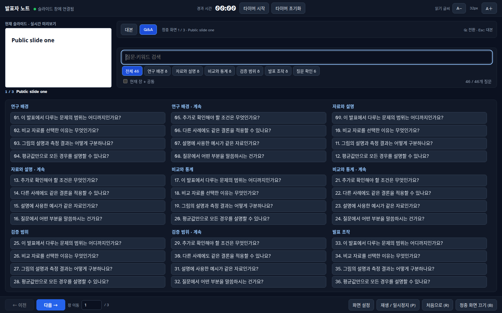

# 발표

`output/<타이틀>_<학생이름>.html` 을 브라우저(Chrome/Edge 권장)에서 열고 `F` 를 입력한다.
다른 컴퓨터에서 발표할 때도 이 파일 하나만 옮겨서 연다. 인터넷 연결은 필요 없다.

## 단축키

| 키 | 동작 |
|---|---|
| `F` | 전체 화면 시작. 현재 슬라이드부터 진행한다 |
| 스페이스 · `→` · `↓` · PageDown · Enter | 다음 장 |
| `←` · `↑` · PageUp · Backspace | 이전 장 |
| Home · End | 처음 · 마지막 |
| `B` | 청중 화면 일시 소등 |
| `P` · `R` | 현재 장 동영상 재생/정지 · 처음으로 |
| `N` | 발표자 노트 창 열기 |
| Esc | 종료 |

슬라이드를 누르면 다음 장으로 넘어간다. 동영상은 그 장에 들어오면 무음으로 자동 재생되고,
벗어나면 멈춘다.

## 레이저 포인터

발표 중에는 슬라이드 위의 마우스 커서가 빨간 레이저 포인터 점으로 바뀐다. 동영상
위에서는 재생 막대를 다룰 수 있도록 기본 커서를 유지한다.

발표자 노트 창의 현재 슬라이드 미리보기와 청중 화면은 레이저 포인터를 서로 공유한다.

| 발표자 노트 창에서 | 청중 화면에서 |
|---|---|
| 청중 화면의 마우스 위치가 미리보기에 빨간 점으로 표시된다 | 마우스 커서가 레이저 점이다 |
| 현재 슬라이드 미리보기 위에 마우스를 올린다. 다음 슬라이드 미리보기나 대본 영역은 가리키지 않는다 | 같은 위치에 레이저 점이 나타난다 |

마우스가 슬라이드 밖으로 나가거나, 청중 화면을 끄거나(`B`), 발표를 끝내면 점이 사라진다.

## 발표자 노트

`N` 또는 **발표자 노트** 버튼으로 별도 창을 연다. 왼쪽에 현재 장, 오른쪽에 다음 장과
대본을 둔다. 슬라이드를 넘기면 대본도 바뀐다. **대본 중심** 버튼으로 대본 칸을 넓힌다.

- 현재 장 미리보기에는 청중 화면의 동영상과 캔버스 애니메이션이 실시간으로 비친다. 다음 장은 정지 미리보기이다
- 미리보기의 동영상은 같은 파일을 발표자 창 안에서 따로 재생하고, 청중 화면의 재생 위치와 재생/정지 상태에 맞춘다. 청중 창이 가려지거나 다른 화면에 있어도 미리보기가 검게 바뀌지 않는다
- 현재 장 미리보기의 동영상 자리에는 점선 테두리와 `재생` / `일시정지` 버튼이 표시된다. 누르면 청중 화면의 그 동영상이 재생되거나 멈추고, 버튼은 청중 화면의 재생 상태를 따라 바뀐다
- 대본은 덱 HTML 의 각 `.slide` 안에 `<aside class="speaker-notes" hidden>` 으로 넣는다
- 노트는 청중 화면과 PDF 에 표시되지 않는다

### Q&A

발표자 창의 **Q&A** 탭은 현재 슬라이드를 위에 계속 보여 주면서, 아래 목록에서 질문을
분류별로 훑어보게 한다. 질문을 고르면 답변을 읽고, **질문 목록** 으로 돌아와 다른 질문을
찾는다. 검색, 분류, 현재 장 필터를 함께 사용할 수 있으며, 질문 선택은 청중 슬라이드를
바꾸지 않는다. `Q` 로 대본과 Q&A 를 전환한다. 질문과 답변은 HTML 의 숨겨진 템플릿에
들어 있어 오프라인으로 사용된다.

### 외부 화면 연결

프로젝터와 노트북을 **확장 모드** 로 연결한 뒤 **화면 설정** 에서 청중 화면과 발표자
화면을 고르고 **발표 시작** 을 누른다. 지원되는 Chrome/Edge 에서는 화면 관리 권한을
받아 슬라이드를 외부 화면에 전체 화면으로 표시하고 노트 창을 다른 화면에 배치한다.
운영체제의 복제에서 확장으로의 전환은 직접 한다(Windows: `Win + P` 에서 확장).
자동 배치가 안 되면 `N` 으로 노트 창을 열어 직접 옮기고 슬라이드 창에서 `F` 를 누른다.

## 참고

- [바로 열어보는 예제](../examples/presenter-notes.html)
- [대본과 Q&A 작성법, 기존 덱 적용](../design/README.md#발표자-노트)
- [브라우저 검증 실행](../tests/README.md)
